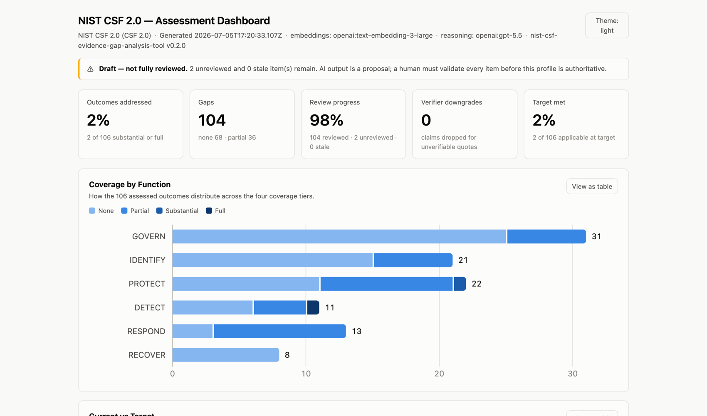
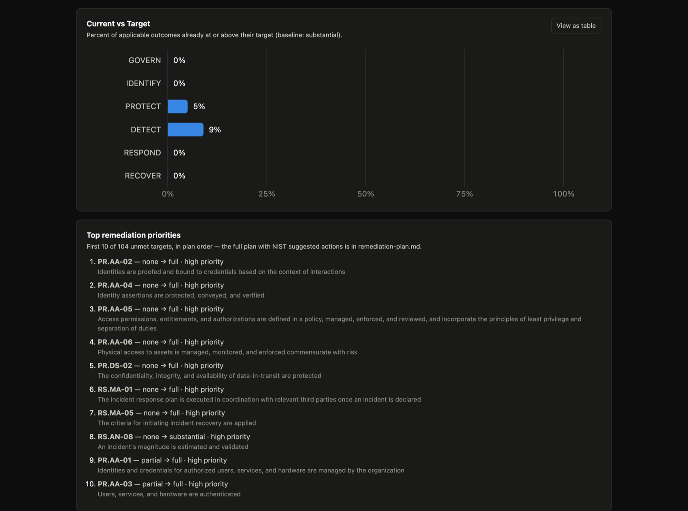
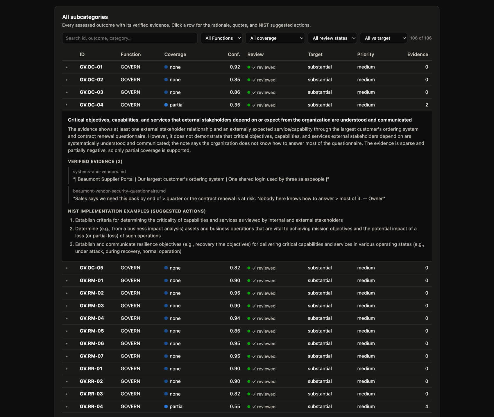

# CSF 2.0 del NIST — Herramienta de análisis de evidencia y brechas asistido por IA

> Versión en español del [README en inglés](README.md). Si alguna vez difieren,
> la versión de referencia es la inglesa. La [Guía de uso](docs/GUIDE.md) está
> disponible solo en inglés.

Una herramienta gratuita y de código abierto que ayuda a cualquier organización
a medir en qué grado sus prácticas de seguridad actuales cumplen el estándar
nacional de seguridad cibernética de los Estados Unidos, el Marco de Seguridad
Cibernética (CSF) 2.0 del NIST, y que muestra con exactitud dónde están las
brechas.

<p align="center">
  <picture>
    <source media="(prefers-color-scheme: dark)" srcset="docs/images/dashboard-dark.png">
    
  </picture>
</p>
<p align="center"><em>Uno de los entregables: <code>dashboard.html</code>, un único archivo autónomo (sin servidor y sin red) con toda la evaluación: cobertura, estado de la revisión, comparación entre lo actual y lo objetivo, y la evidencia verificada de cada resultado.</em></p>

## Propósito e importancia

La seguridad cibernética es una prioridad nacional reconocida en los Estados
Unidos: los ataques contra empresas, hospitales, escuelas, servicios públicos y
gobiernos locales causan graves daños económicos y públicos. Para ayudar a las
organizaciones a gestionar ese riesgo, el Instituto Nacional de Estándares y
Tecnología (NIST) del gobierno de los Estados Unidos publica el Marco de
Seguridad Cibernética (CSF) 2.0, un estándar nacional común y de uso extendido
que define 106 resultados de seguridad cibernética que una organización debería
alcanzar. (Un «resultado» es un logro concreto que la organización debería poder
demostrar; por ejemplo, mantener un inventario actualizado de su hardware.)

En la práctica, la evidencia de cómo se protege realmente una organización está
repartida en decenas o cientos de documentos (políticas de seguridad,
procedimientos, informes de auditoría, estándares y registros internos), a
menudo dispersos entre distintos equipos y sistemas. Leer todo eso a mano y
asociar cada elemento de evidencia con el resultado correcto del marco del NIST
es laborioso, lento y propenso a errores, incluso para especialistas formados.
Ese es el principal obstáculo práctico para adoptar el estándar.

Este proyecto aborda ese obstáculo. Revisa automáticamente los documentos de la
propia organización frente a los 106 resultados definidos por el CSF 2.0 del
NIST, localiza la evidencia de respaldo y las brechas, y produce un informe
claro, lo que acelera un trabajo que resulta laborioso incluso para especialistas
en seguridad con experiencia. Como es gratuito, está abierto a todos y puede
ejecutarse por completo en el equipo del usuario, los documentos sensibles no
tienen por qué salir de las instalaciones. Así, a cualquier organización le
resulta viable obtener una imagen rigurosa y basada en evidencia de su situación
actual frente al estándar (lo que el marco denomina un «Perfil Actual»), y el
trabajo se vuelve más rápido y más uniforme para los especialistas que lo
realizan. Una adopción más amplia y más uniforme de una base común de seguridad
cibernética refuerza la resiliencia de la economía en general y de los servicios
públicos críticos.

Para que sus resultados sean dignos de confianza, la herramienta nunca deja la
última palabra a la IA: cada hallazgo debe estar respaldado por una cita exacta
de los documentos de la propia organización, y una persona revisa y confirma
cada uno.

## Contenido

- [Propósito e importancia](#propósito-e-importancia)
- [Qué hace](#qué-hace)
- [Cómo funciona](#cómo-funciona)
- [Instalación](#instalación)
- [Inicio rápido (sin conexión y sin clave de API)](#inicio-rápido-sin-conexión-y-sin-clave-de-api)
- [Uso](#uso)
- [Proveedores, privacidad y modo sin conexión](#proveedores-privacidad-y-modo-sin-conexión)
- [Entregables](#entregables)
- [Cómo respalda el CSF 2.0](#cómo-respalda-el-csf-20)
- [Relaciones con otros marcos](#relaciones-con-otros-marcos)
- [Salvaguardas contra las alucinaciones](#salvaguardas-contra-las-alucinaciones), con [resultados medidos](eval/RESULTS.md)
- [Configuración](#configuración)
- [Fuentes de datos](#fuentes-de-datos)
- [Limitaciones](#limitaciones)
- [Cómo citar esta herramienta](#cómo-citar-esta-herramienta)
- [Documentación del proyecto](#documentación-del-proyecto)
- [Licencia](#licencia)

## Qué hace

Se le indica a la herramienta una carpeta con los documentos de la organización
(políticas de seguridad, informes SOC 2, documentación de ISO 27001,
procedimientos internos). A partir de ahí:

1. **Incorpora** los documentos: los analiza, los divide en fragmentos
   solapados, calcula sus embeddings y lo guarda todo en un índice local en
   disco.
2. **Analiza** la cobertura: para **cada una** de las 106 Subcategorías del CSF
   2.0 recupera los fragmentos de documento más pertinentes y pregunta a un motor
   de IA si esa evidencia muestra que el resultado se alcanza realmente.
3. **Revisión**: un paso con intervención humana en el que se acepta, se corrige
   o se anota cada valoración de la IA junto con la evidencia que la respalda.
4. **Objetivo** (opcional): se declara un Perfil Objetivo, es decir, la cobertura
   deseada para cada resultado (con valores específicos por Función, Categoría o
   Subcategoría), las prioridades y los resultados que quedan fuera de alcance.
   También se puede registrar quién es responsable de cada acción y para cuándo,
   y la selección de Nivel del CSF de la organización. Todas estas son
   decisiones humanas; no interviene ninguna IA.
5. **Informes**: convierte las evaluaciones revisadas en un Perfil Actual (JSON),
   un informe de análisis de brechas (Markdown), un mapa de evidencia (CSV) y un
   panel HTML autónomo; y, cuando existe un objetivo, en un Perfil Objetivo
   (JSON) y un **plan de acción priorizado** cuyas acciones sugeridas son los
   propios Ejemplos de implementación del CSF 2.0 del NIST, citados
   textualmente, con un registro de seguimiento de tipo POA&M (CSV) de sus
   elementos abiertos. Otros tres informes leen la misma evaluación desde otros
   ángulos: qué aporta cada documento, qué preguntar allí donde un resultado no
   pudo demostrarse y qué identificadores de otros marcos (NIST SP 800-53, CIS
   Controls y otros) están relacionados con cada resultado.

Los informes, el panel y la respuesta de `ask` también pueden generarse en
**español** (`--lang es`). El texto propio de la herramienta está traducido; los
nombres de las Funciones y de las Categorías y los resultados de las
Subcategorías se muestran en la traducción oficial al español del CSF 2.0
publicada por el NIST (NIST CSWP 29 spa): la herramienta no traduce por su
cuenta texto del marco. La evaluación se ejecuta siempre sobre el Core en
inglés, y los archivos legibles por máquina son los mismos en ambos idiomas.

En cualquier momento, el comando de solo lectura **`status`** resume el estado
guardado de esas etapas, señala las revisiones o los informes desactualizados e
indica el siguiente comando que conviene ejecutar.

Una vez incorporados los documentos, el comando de solo lectura **`ask`**
responde una única pregunta a partir de ellos, por ejemplo «¿se exige MFA para
el acceso remoto?». Solo muestra una respuesta junto con citas que ha verificado
palabra por palabra en los documentos; en caso contrario, indica que no encontró
evidencia verificable. Lo verificado son las citas: la frase de resumen que las
precede es redacción del modelo y no se verifica.

Para un recorrido completo paso a paso, véase la **[Guía de uso](docs/GUIDE.md)**
(en inglés).

## Cómo funciona

### «RAG invertido»

En lugar de que un usuario haga preguntas, la herramienta recorre todas las
Subcategorías y, para cada una, recupera los k fragmentos de documento más
cercanos y pide a la IA que evalúe la cobertura **solo frente a esa evidencia
recuperada**. Los embeddings están normalizados (L2), de modo que la similitud
del coseno es un simple producto escalar, y la recuperación es un recorrido
exacto en memoria: el corpus son los documentos de una sola organización, por lo
que no hace falta ninguna base de datos externa ni servicio vectorial.

### Resultados, no temas

Las Subcategorías del CSF 2.0 son *resultados*, no controles ni temas. La
herramienta valora si la evidencia muestra que un resultado se alcanza
realmente, y no solo que el asunto se menciona. Una política que dice que algo
«debe» hacerse se considera una evidencia más débil que los registros que
muestran que efectivamente se hace.

## Instalación

Requiere **Node.js >= 20.10**.

```bash
git clone https://github.com/MarianoFacundoArch/nist-csf-evidence-gap-analysis-tool.git
cd nist-csf-evidence-gap-analysis-tool
npm install
```

`npm install` descarga dos dependencias obligatorias y pequeñas (`ajv` para la
validación de esquemas y `@clack/prompts` para el menú interactivo). Las
dependencias más pesadas de proveedores y analizadores (`openai`,
`@huggingface/transformers`, `mammoth`, `pdfjs-dist`) están declaradas como
**opcionales** y solo se cargan cuando se usa realmente el proveedor o el tipo de
archivo correspondiente.

Para usar el comando de forma global como `csf-tool`, se ejecuta `npm link`. El
comando enlazado puede ejecutarse desde cualquier directorio (la carpeta de un
cliente, por ejemplo): cuando ese directorio no tiene archivos `data/` propios,
se usan los datos del CSF que se distribuyen con la herramienta. Los ejemplos
que siguen usan `node bin/csf-tool.js`.

## Inicio rápido (sin conexión y sin clave de API)

Para ejecutar todo el proceso sobre los documentos de ejemplo incluidos, con un
motor **mock** determinista, sin red y sin clave de API:

```bash
node bin/csf-tool.js all \
  --docs examples/sample-docs \
  --embed-provider mock --llm-provider mock \
  --work-dir ./output --accept-all
```

Después se puede abrir `./output/reports/gap-analysis.md`, y
`./output/reports/dashboard.html` en un navegador para la vista interactiva. En
`examples/worked-example/` hay una copia de referencia incluida en el
repositorio, que se regenera byte a byte con `npm run example`.

(`--accept-all` acepta la cola de revisión sin preguntar, para que la
demostración se ejecute sin intervención. De forma predeterminada, la cola solo
contiene los elementos marcados para revisión; los demás quedan sin revisar, por
lo que los informes de esta ejecución llevan la marca DRAFT (BORRADOR en los
informes en español). Una evaluación real usa en su lugar el paso de revisión
humana; véase [Uso](#uso).)

## Uso

Hay dos formas de manejar la herramienta, y ambas comparten el **mismo** código
subyacente.

**Menú interactivo** (sin indicar ningún comando; guía por cada paso):

```bash
node bin/csf-tool.js
```

**Modo de comandos:**

```bash
node bin/csf-tool.js init       # crea un archivo de configuración, .env y el directorio de trabajo
node bin/csf-tool.js ingest     # analiza, fragmenta, calcula embeddings e indexa los documentos
node bin/csf-tool.js analyze    # valoraciones de cobertura de la IA para las 106 Subcategorías
node bin/csf-tool.js review     # validación con intervención humana
node bin/csf-tool.js target     # define el Perfil Objetivo (objetivos y prioridades)
node bin/csf-tool.js report     # genera los entregables
node bin/csf-tool.js status     # muestra el progreso guardado, su vigencia y el siguiente paso
node bin/csf-tool.js crosswalk  # lista los mapeos a otros marcos disponibles para los informes
node bin/csf-tool.js all        # ejecuta todo el proceso de principio a fin
node bin/csf-tool.js ask "Is MFA required for remote access?"   # pregunta a los documentos incorporados
```

La etapa `target` es interactiva en una terminal; para ejecuciones automatizadas
se usa `--target-default <nivel>` (fija el objetivo predeterminado) o
`--target-import <ruta>` (para aportar una especificación propia, por ejemplo
una derivada de un Perfil Comunitario del NIST), o bien se edita a mano
`<work-dir>/target.json`, que es JSON sencillo y validado. `--tier-current <1-4>`
y `--tier-target <1-4>` registran del mismo modo la selección de Nivel del CSF
de la organización. El responsable, la fecha límite y el estado de cada acción
se registran a mano en `target.json` (véase la
[Guía de uso](docs/GUIDE.md#8-the-target-profile-and-the-remediation-plan)).

`--lang es` (o `"report": { "language": "es" }` en el archivo de configuración)
escribe los entregables y la respuesta de `ask` en español; el idioma
predeterminado es el inglés. `report --lang es` solo vuelve a generar los
informes de la evaluación existente. Con `analyze` y `all`, además pide al
modelo que escriba sus fundamentos en español, por lo que, en un directorio de
trabajo que se analizó en inglés, `analyze` vuelve a evaluar todos los
resultados (véase el apartado
[Reports in Spanish](docs/GUIDE.md#reports-in-spanish) de la Guía de uso).

`--crosswalk <ids|default|all|none>` elige los mapeos a otros marcos que
incluyen `report` y `all`: de forma predeterminada, todos excepto los de
terceros (véase [Relaciones con otros marcos](#relaciones-con-otros-marcos)).

`ask` solo necesita el índice que construyó `ingest`: no lee ninguna evaluación
y no escribe nada. Lee los pasajes recuperados para la pregunta
(`retrieval.topK`, 6 de forma predeterminada) y ningún otro, de modo que su
mensaje «No verifiable evidence in the ingested documents answers this
question.» (con `--lang es`: «Ninguna evidencia verificable de los documentos
incorporados responde a esta pregunta.») significa «no se encontró ahí», y no
«los documentos no dicen nada al respecto».

`status` se puede ejecutar siempre que se quiera un punto de control compacto,
sin modificar ningún dato de la evaluación:

```bash
node bin/csf-tool.js status
```

La forma equivalente como script del paquete es
`npm run status -- --work-dir <ruta>`. Informa del estado de la incorporación,
el análisis, la revisión, el objetivo y la generación de informes; distingue las
revisiones vigentes de las que han quedado desactualizadas por un cambio en la
evaluación; señala los informes anteriores a una actividad más reciente de
incorporación, análisis, revisión u objetivo (o cuya instantánea de entradas
guardada o cuyo conjunto de entregables ya no coincide); valida el objetivo, que
se puede editar a mano; y termina con una recomendación concreta
`Next: <command>`. La misma vista está disponible en el menú interactivo. Tras
actualizar un directorio de trabajo creado antes de la v0.2.1, hay que ejecutar
una vez el comando `report` recomendado para generar su instantánea exacta de
entradas; a partir de entonces, las ediciones manuales posteriores se detectan
aunque sus marcas de tiempo no cambien.

Cada etapa guarda su salida, de modo que se puede parar después de cualquiera de
ellas y continuar más tarde. `analyze` es reanudable: los elementos ya evaluados
se omiten salvo que hayan cambiado sus entradas (o se indique `--force`). Las
etapas largas también informan de su progreso: la incorporación muestra la
posición del archivo y el porcentaje, el análisis informa cada diez resultados
(incluidos los reutilizados de la caché) con el tiempo transcurrido y un tiempo
restante aproximado, y la revisión muestra la posición en su cola. Con `--help`
se obtienen todas las opciones, y la **[Guía de uso](docs/GUIDE.md)** (en inglés)
ofrece un recorrido detallado.

## Proveedores, privacidad y modo sin conexión

La herramienta es modular. No hay nada fijado en el código: se elige dónde se
calculan los embeddings y dónde se hace el razonamiento.

- **Embeddings:** `local-transformers` (en el propio equipo; los documentos no
  salen de él), `openai` (en la nube) o `mock` (determinista, para pruebas).
- **LLM de razonamiento:** `openai` (en la nube), `ollama` (un modelo totalmente
  local en el propio equipo) o `mock`.

La configuración predeterminada usa la nube (hay que definir `OPENAI_API_KEY` en
`.env`). Con **`--local`** la ejecución es totalmente sin conexión (embeddings en
el equipo y un modelo local de Ollama); ningún documento ni instrucción (prompt)
sale del equipo. La vía sin conexión requiere [Ollama](https://ollama.com): hay
que instalarlo, iniciarlo con `ollama serve` y descargar antes un modelo (por
ejemplo, `ollama pull llama3.2`). Si `OLLAMA_HOST` apunta a cualquier dirección
que no sea de bucle local, Ollama no se trata como local: las instrucciones se
envían a ese host, y la herramienta lo advierte. Los nombres de los modelos son
configurables; si no se indica un modelo, cada proveedor aplica un valor
predeterminado propio y razonable, y el proveedor de OpenAI se adapta
automáticamente entre generaciones de modelos (por ejemplo, a las convenciones
de parámetros de la familia GPT-5).

### Enmascaramiento de identificadores (opcional)

Con un proveedor en la nube, se le envía texto de los documentos. `--redact` (o
`"privacy": { "redact": true }` en el archivo de configuración) sustituye las
direcciones de correo electrónico, las URL, las direcciones IP y MAC, los
nombres de host y los términos literales indicados en `privacy.terms` por
marcadores como `[[EMAIL_1]]` antes de que una solicitud salga del equipo, y
restituye los originales, localmente, en la respuesta. Las citas se siguen
verificando contra los documentos propios, y los informes muestran el texto
original.

**Se trata de una seudonimización de los identificadores que coinciden con un
patrón o con un término indicado. No es una anonimización**, y no hace que sea
seguro enviar documentos que no deben salir de la organización; para esos hay
que usar `--local`.

- Todo lo demás se envía tal como está escrito, y puede seguir identificando a
  la organización y a las personas que la integran: el texto circundante, los
  nombres de personas y de empresas (salvo que se indiquen), los cargos, las
  direcciones postales, los números de teléfono, los números de cuenta y de
  identidad, las contraseñas y claves, los nombres de equipo sin punto y los
  nombres de archivo de los documentos (salvo que contengan un término
  indicado).
- Hay que activarlo antes de `ingest`. Con el enmascaramiento activado, los
  documentos se dividen en pasajes sin partir una dirección ni un nombre
  indicado, y `analyze` y `ask` rechazan un índice construido sin
  enmascaramiento o con una lista `privacy.terms` distinta. Un valor que queda
  en dos partes se sigue enviando parcialmente: uno más largo que un pasaje
  entero, un nombre o una URL que continúa en la página siguiente de un PDF, y
  una URL o una dirección que el documento parte entre dos líneas.
- Solo afecta a los proveedores que no están en el propio equipo, y la
  herramienta lo determina por la dirección. Un servicio de Ollama al que se
  accede mediante un `OLLAMA_HOST` que no es de bucle local cuenta como remoto,
  y la herramienta lo advierte; una dirección local que reenvía a otro equipo
  parece local, y lo que se envía por ella no se enmascara.
- Los marcadores cambian lo que ven el modelo y el generador de embeddings, lo
  que puede cambiar qué se recupera y cómo se valora un resultado. La
  evaluación publicada ([`eval/RESULTS.md`](eval/RESULTS.md)) se hizo sin
  enmascaramiento y no midió su efecto.
- Un ajuste de `privacy` con un valor no válido, con el nombre mal escrito o en
  un lugar equivocado detiene la ejecución con un error, en lugar de volver al
  valor «desactivado», y lo mismo ocurre con un archivo de configuración que no
  se puede leer. Hay dos errores que no se detectan, y en ambos no se enmascara
  nada: la propia palabra `privacy` mal escrita es una clave desconocida, que
  se ignora con una advertencia, y un comando ejecutado desde un directorio que
  no contiene el archivo de configuración usa los valores predeterminados.
  Conviene comprobar que `ingest`, `analyze` y `ask` muestran «Redaction is on
  for …»; la Guía de uso explica cómo comprobarlo antes de que se envíe nada.
- Después de activar o desactivar el enmascaramiento, la herramienta indica
  cuándo hay que volver a ejecutar `ingest`, y recalcula las evaluaciones. El
  texto ya enviado no se puede recuperar.

La [Guía de uso](docs/GUIDE.md#redacting-identifiers-sent-to-a-cloud-provider)
(en inglés) muestra una solicitud enmascarada, detalla exactamente qué se
sustituye y qué no, y recoge todos los límites que quedan.

## Entregables

Se escriben en `<work-dir>/reports/`:

- **`current-profile.json`**: un Perfil Actual legible por máquina, alineado con
  el concepto de Perfil Organizativo del CSF 2.0: una entrada por Subcategoría
  con la cobertura (`none` / `partial` / `substantial` / `full`), la confianza,
  las citas de evidencia, los valores de la IA y los humanos, el estado de
  revisión y las marcas de tiempo de actividad registradas para la evaluación.
- **`gap-analysis.md`**: un informe legible por personas, agrupado por Función,
  con un resumen de cobertura y **las brechas en primer lugar** (más una sección
  de comparación entre lo actual y lo objetivo cuando existe un Perfil
  Objetivo).
- **`evidence-map.csv`**: vincula cada Subcategoría con sus archivos de origen y
  sus citas textuales (entrecomillado según RFC 4180, con protección contra la
  inyección de fórmulas en hojas de cálculo).
- **`evidence-by-document.md`**: la vista inversa: para cada documento, para
  cuántos resultados fue recuperado, para qué resultados se lo cita y cuántas
  citas verificadas aporta; a continuación, los documentos que se incorporaron
  pero nunca se citaron. «Nunca citado» significa solo que ningún pasaje fue
  seleccionado como evidencia textual de un resultado del CSF en esta
  evaluación; no significa que el documento sea irrelevante.
- **`evidence-requests.md`**: qué preguntar y qué recopilar a continuación. La
  ausencia de evidencia se evalúa como `none`, pero no equivale a la ausencia de
  un control: a menudo la organización hace lo que corresponde y simplemente no
  entregó el documento. Para cada resultado que no pudo demostrarse (con un
  Perfil Objetivo: cada objetivo no cumplido), la lista ofrece tres preguntas
  fijas y una lista de verificación de lo que podría demostrarlo: los Ejemplos
  de implementación del NIST para ese resultado, textualmente.
- **`dashboard.html`**: un panel interactivo autónomo (se abre con un doble
  clic; funciona sin conexión, sin CDN, sin fuentes externas y sin red de ningún
  tipo). Gráficos de cobertura, estado de la revisión y un explorador con
  filtros de los 106 resultados con sus citas verificadas; una tabla de
  evidencia por documento; una instantánea de la actividad de la evaluación con
  fechas legibles; filtros rápidos para brechas, revisiones pendientes,
  objetivos no cumplidos y todo lo que requiere atención; indicadores visibles
  de las correcciones del revisor; búsqueda ampliada en fundamentos, notas,
  evidencia y acciones sugeridas; temas claro y oscuro; cada gráfico tiene una
  vista de tabla. Como es un archivo generado y sin conexión, su vista de
  actividad es una instantánea del momento en que se generó el informe; hay que
  volver a ejecutar `report` después de un trabajo más reciente.

Cuando existe un Perfil Objetivo, otros tres entregables completan el par de
Perfiles Organizativos del CSF 2.0 y su plan de acción:

- **`target-profile.json`**: el Perfil Objetivo legible por máquina: cobertura
  actual frente a la objetivo, tamaño de la brecha, prioridad y alcance por
  Subcategoría, con los campos del plan y la selección de Nivel del CSF que se
  hayan registrado.
- **`remediation-plan.md`**: el plan de acción priorizado que conecta los dos
  perfiles: los objetivos no cumplidos, ordenados según las prioridades
  definidas y la distancia al objetivo, cada uno con los Ejemplos de
  implementación oficiales del NIST como acciones sugeridas (textuales y de
  dominio público; la herramienta nunca inventa recomendaciones), y con el
  responsable, la fecha límite y el estado que se hayan registrado para él.
- **`poam.csv`**: los mismos elementos abiertos como un registro de seguimiento
  de tipo POA&M (Plan de Acción e Hitos): una fila por objetivo no cumplido, con
  un identificador estable y con el responsable, la fecha límite, el estado y
  los hitos definidos por la organización. Estos se leen de `target.json` y
  nunca se inventan: una celda vacía significa que todavía nadie lo ha decidido.
  Es una exportación sencilla para el seguimiento, no una reproducción de la
  plantilla de POA&M de ningún organismo.

Cuando se ha registrado una selección de Nivel del CSF, `gap-analysis.md`,
`remediation-plan.md` y el panel la muestran, indicada como seleccionada por la
organización.

Para los mapeos seleccionados (de forma predeterminada, todos excepto los de
terceros), dos archivos más relacionan la evaluación con otros marcos; ambos se
eliminan cuando no hay ninguno seleccionado:

- **`crosswalk.md`**: cómo leerlo y, para cada mapeo, quién lo elaboró y dónde
  figura, y cada uno de los identificadores del marco con los resultados del
  CSF 2.0 relacionados con él y la cobertura hallada para esos resultados.
- **`crosswalk.csv`**: las mismas relaciones en forma de datos, una por fila,
  para filtrar en una hoja de cálculo o cargar en una herramienta de GRC.

El panel lista los mismos identificadores bajo cada resultado, y su búsqueda los
encuentra.

No se llama a ningún modelo para escribir el informe de evidencia por documento,
la lista de solicitudes de evidencia, la exportación de tipo POA&M ni los
archivos de relaciones con otros marcos: se calculan a partir de la evaluación,
del Perfil Objetivo y de los datos distribuidos con la herramienta, y los
fundamentos que repiten son los de la evaluación.

**Idioma.** Con `--lang es`, los informes en Markdown y `dashboard.html` se
escriben en español con los mismos nombres de archivo. Los nombres de las
Funciones y de las Categorías y los resultados son el texto en español publicado
por el propio NIST; cada informe lo indica y señala que la evaluación se realizó
con el original en inglés. Los Ejemplos de implementación del NIST se muestran
en inglés, porque el NIST solo los publica en ese idioma, y las citas de los
documentos nunca se traducen. Los archivos JSON y CSV son interfaces para otros
programas: sus claves, encabezados y valores permanecen en inglés y, para una
misma evaluación, son los mismos bytes en ambos idiomas, salvo la marca de
tiempo de generación.

<p align="center">
  
</p>
<p align="center"><em>Lo actual frente a lo objetivo y la lista de acciones ordenada: las prioridades y los objetivos los define la organización; el orden es determinista.</em></p>

<p align="center">
  
</p>
<p align="center"><em>Cada resultado, con su detalle: el fundamento de la IA, las citas verificadas palabra por palabra en los documentos y las acciones sugeridas del propio NIST.</em></p>

Extracto de ejemplo de un informe de análisis de brechas (generado en inglés,
el idioma predeterminado):

```
## Coverage by Function

| Function | Total | None | Partial | Substantial | Full | % addressed |
| --- | ---: | ---: | ---: | ---: | ---: | ---: |
| GOVERN | 31 | 16 | 15 | 0 | 0 | 0% |
| IDENTIFY | 21 | 13 | 7 | 1 | 0 | 5% |
...

## Gaps and partial coverage (address these first)

### IDENTIFY
- **ID.RA-01** — _none_
  - Outcome: Vulnerabilities in assets are identified, validated, and recorded
  - Rationale: The evidence shows asset inventory and access reviews, but does
    not demonstrate that vulnerabilities are identified, validated, and recorded.
```

## Cómo respalda el CSF 2.0

- **Cubre todo el CSF Core.** Evalúa el CSF Core 2.0 completo (las 6 Funciones,
  las 22 Categorías y las 106 Subcategorías) y produce un Perfil Actual, el
  artefacto que el CSF 2.0 recomienda para comprender la postura actual de
  seguridad cibernética.
- **El ciclo completo del Perfil Organizativo.** El CSF 2.0 plantea un Perfil
  Organizativo como un Perfil Actual *y* un Perfil Objetivo, que se comparan
  para producir un plan de acción. La herramienta cubre todo el ciclo: evaluar →
  revisar → fijar objetivos → plan de acción priorizado, y las acciones
  sugeridas del plan se toman textualmente de los propios Ejemplos de
  implementación del CSF 2.0 del NIST.
- **De las brechas a un plan con seguimiento.** El paso 4 de la Sección 3.1 del
  CSF 2.0 indica: «desarrolle un plan de acción priorizado (por ejemplo,
  registro de riesgos, informe detallado de riesgos, Plan de Acción e Hitos
  [POA&M]) para abordar esas brechas». La herramienta escribe ese plan y exporta
  sus elementos abiertos como un registro de seguimiento de tipo POA&M; quién es
  responsable de cada elemento, y para cuándo, lo registran las personas que lo
  deciden, nunca la herramienta.
- **Los tres componentes del CSF 2.0.** El CSF 2.0 consta del Core, los Perfiles
  Organizativos y los Niveles. En palabras del NIST (Sección 3.2), «Los niveles
  caracterizan el rigor de las prácticas de gobernanza y gestión de los riesgos
  de seguridad cibernética de una organización», y «Una organización puede
  elegir utilizar los Niveles para informar sus Perfiles Actual y Objetivo.» Un
  Nivel lo selecciona la organización y no es una función de la cobertura de las
  Subcategorías, por lo que la herramienta nunca deduce ni sugiere uno: registra
  la selección, actual y objetivo, y la traslada a los entregables, indicada
  como propia de la organización. Para el significado de cada Nivel, véase el
  Apéndice B de NIST CSWP 29.
- **Referencias informativas.** Los mapeos publicados a través del programa
  National Online Informative References (OLIR) del NIST relacionan los
  resultados del CSF 2.0 con los controles y requisitos de otros marcos. La
  herramienta incluye una selección de ellos y lista, para cada identificador de
  otro marco, los resultados evaluados que se relacionan con él: como
  relaciones, nunca como una afirmación sobre ese marco (véase
  [Relaciones con otros marcos](#relaciones-con-otros-marcos)).
- **Exacta por construcción.** El texto de las Subcategorías y los Ejemplos de
  implementación se toman textualmente de la exportación oficial de NIST CPRT
  (reproducible con `npm run build-csf-core`); toda afirmación de cobertura de
  la IA debe estar respaldada por una cita que el código verifica palabra por
  palabra en la evidencia de origen, y nada es definitivo hasta que una persona
  lo valida.
- **Gratuita y reutilizable.** Licencia MIT; puede ejecutarse totalmente sin
  conexión; no se requiere ninguna cuenta, suscripción ni servicio de pago.

## Relaciones con otros marcos

Una organización rara vez trabaja con un solo marco. Una vez evaluados los
resultados del CSF 2.0, una pregunta habitual es «¿qué controles del marco X
toca esto?». El NIST publica las relaciones necesarias para responderla a
través de su programa National Online Informative References (OLIR): mapeos
entre el CSF 2.0 y los elementos de otros documentos, cada uno de los cuales
figura con su autor en el
[catálogo del NIST](https://csrc.nist.gov/projects/olir/informative-reference-catalog).
La herramienta incluye una selección de esos mapeos como datos y no añade
ninguno propio:

| Id | Marco | Mapeo elaborado por | Inclusión |
| --- | --- | --- | --- |
| `sp800-53-r5` | NIST SP 800-53 Rev. 5.2.0 | NIST | predeterminada |
| `sp800-171-r3` | NIST SP 800-171 Rev. 3 | NIST | predeterminada |
| `sp800-218-ssdf` | NIST SP 800-218 (SSDF) v1.1 | NIST | predeterminada |
| `csf-1.1` | NIST Cybersecurity Framework v1.1 | NIST | predeterminada |
| `cis-v8.1` | CIS Critical Security Controls v8.1 | Center for Internet Security | predeterminada |
| `csa-ccm-v4` | CSA Cloud Controls Matrix v4.0 | Cloud Security Alliance | predeterminada |
| `cri-profile-v2` | CRI Profile v2.0 | Cyber Risk Institute | predeterminada |
| `scf-2024.4` | Secure Controls Framework (SCF) 2024.4 | SCF Council | predeterminada |
| `iso27001-2022` | ISO/IEC 27001:2022 | un tercero (no quien publica el marco) | a petición |
| `pci-dss-4.0.1` | PCI DSS v4.0.1 | un tercero (no quien publica el marco) | a petición |

Para listarlos con la copia de los datos que se esté usando, y para elegir los
que incluye un informe:

```bash
node bin/csf-tool.js crosswalk
node bin/csf-tool.js report --crosswalk sp800-53-r5,cis-v8.1
```

`--crosswalk` admite identificadores, `default`, `all` o `none`; con
`report.crosswalks` en el archivo de configuración la elección queda fijada.

**Qué indica un mapeo y qué no.**

- Un mapeo registra que un resultado del CSF y una referencia están
  **relacionados**; no que sean equivalentes ni que alcanzar uno satisfaga el
  otro.
- La cobertura que se muestra junto a un resultado es evidencia **solo sobre ese
  resultado del CSF**, no una determinación de conformidad con el control o
  requisito referenciado. La herramienta informa de relaciones, y de cuántas
  referencias tienen una brecha entre sus resultados relacionados; nunca de un
  porcentaje ni de un estado para el otro marco.
- Un mapeo relaciona una referencia con **un resultado, una Categoría entera o
  una Función entera**. Los entregables mantienen separados esos casos y nunca
  reducen una Categoría entera a un único valor de cobertura.
- Los datos contienen **solo identificadores** (números de control, de requisito
  o de cláusula). No se reproduce ningún texto de controles ni de requisitos;
  para saber qué exige un identificador hay que consultar la publicación del
  propio marco.
- Cada mapeo fue elaborado por **el autor que figura para él** en el catálogo del
  NIST. Su inclusión aquí no supone un respaldo del NIST ni de este proyecto.

**Los mapeos de terceros son opcionales.** De forma predeterminada, los
entregables solo incluyen mapeos elaborados por el NIST o por el organismo que
publica el marco correspondiente. Para dos estándares de los que el catálogo no
recoge ningún mapeo de quien los publica (ISO/IEC 27001:2022 y PCI DSS v4.0.1),
los datos incluyen mapeos elaborados por otras partes. Hay que elegirlos de
forma deliberada (indicando su nombre o con `all`), aparecen señalados como
«mapeo de terceros» («third-party mapping» en los informes en inglés) allí donde
se muestran y se reproducen tal como se publicaron, incluidas las entradas que
no son específicas o que parecen erróneas.

Leído así, un mapeo es una ayuda para orientarse: muestra qué resultados
evaluados (y, por tanto, qué documentos y citas de la organización) conviene
abrir al preparar el trabajo con otro marco. La
[Guía de uso](docs/GUIDE.md#9-crosswalks-to-other-frameworks) (en inglés)
explica cómo leer `crosswalk.md` y `crosswalk.csv`.

## Salvaguardas contra las alucinaciones

La IA está limitada tanto por sus instrucciones como, sobre todo, por el código:

- **Instrucciones ligadas a la evidencia.** El modelo solo puede usar la
  evidencia que se le pasa, nunca debe suponer un control que no ha visto y
  trata la ausencia de evidencia como `none`.
- **Sin cita, no cuenta.** Toda cobertura superior a `none` debe incluir al menos
  una cita copiada textualmente de la evidencia.
- **Verificación palabra por palabra (en el código).** Después de que el modelo
  responde, la herramienta comprueba que cada cita existe realmente como
  subcadena de la evidencia recuperada (normalizando espacios y mayúsculas) y
  que es sustantiva. Si una afirmación de cobertura superior a `none` no tiene
  ninguna cita verificable, **se rebaja a `none`** y se marca. Esta es la
  comprobación que decide: la cita del modelo nunca se da por buena sin
  verificarla.
- **Umbral de confianza**: marca para revisión las valoraciones de baja
  confianza.
- **Validación de esquema y alternativa segura.** La salida del modelo se valida;
  si no es válida, la herramienta reintenta una vez y después recurre a `none`
  con revisión obligatoria; nunca falla de forma abrupta.
- **Revisión humana obligatoria.** Los elementos sin revisar o con revisión
  desactualizada se marcan claramente en todos los entregables, y un **modo
  estricto** se niega a emitir el perfil final hasta que todos los elementos
  han sido revisados.

**Estas salvaguardas están medidas, no solo afirmadas.**
[`eval/RESULTS.md`](eval/RESULTS.md) recoge los experimentos, y [`eval/`](eval/)
contiene el entorno de evaluación y las salidas sin procesar de los modelos que
respaldan cada cifra:

| Experimento | Resultado |
| --- | --- |
| 13 modelos (en la nube y locales), 106 Subcategorías | citas inventadas antes de verificar: 0.0–17.7%; **entregadas: 0.0% en todos los modelos** |
| 122 citas adversarias elaboradas a propósito | **100% detectadas**, 0% de rechazo indebido de citas legítimas |
| Ablación sobre 642 citas reales | sin el verificador, el **4.7%** de las citas entregadas serían inventadas |

La fidelidad resultó depender de la *familia* del modelo y no de su tamaño (un
modelo local de 9B igualó a los mejores modelos en la nube, mientras que uno de
8B de otra familia inventó el 17.7%), y por eso se verifica en el código en
lugar de confiar en un único modelo.

## Configuración

Precedencia (de menor a mayor): valores predeterminados integrados <
`csf-tool.config.json` < opciones de la línea de comandos. Los secretos y las
direcciones de servicio proceden únicamente de `.env`. `csf-tool init` crea un
archivo de configuración inicial. Un archivo de configuración que no es un
objeto JSON válido, o una ruta `--config` que no corresponde a ningún archivo,
detiene la ejecución; si no hay ningún archivo de configuración, la herramienta
usa sus valores predeterminados. La referencia completa está en la
[Guía de uso](docs/GUIDE.md#14-configuration-reference) (en inglés). Campos
principales: `csfCorePath`, `crosswalkPath`, `docsPath`, `workDir`,
`chunk.size`/`overlap`, `embeddings.provider`/`model`, `llm.provider`/`model`,
`llm.reasoningEffort`, `retrieval.topK`, `analysis.confidenceThreshold`,
`analysis.critique`, `analysis.strict`, `review.showAll`, `report.crosswalks`,
`report.language`, `privacy.redact`, `privacy.terms`.

`llm.reasoningEffort` (`low` | `medium` | `high`; valor predeterminado: `low`)
es una indicación para los modelos de razonamiento que la aceptan, y los que no
la aceptan la ignoran. El valor predeterminado es `low` porque el barrido medido
en [`eval/RESULTS.md`](eval/RESULTS.md#4-reasoning-effort-sweep-gpt-55) no halló
ninguna mejora de fidelidad con `medium` ni con `high` en esta tarea, con una
latencia aproximadamente doble.

`report.crosswalks` selecciona los mapeos a otros marcos que se incluyen en los
informes (`null`, el valor predeterminado, para todos excepto los de terceros;
una lista de identificadores para exactamente esos; `[]` para ninguno), y
`privacy.redact` / `privacy.terms` controlan el
[enmascaramiento](#enmascaramiento-de-identificadores-opcional).
`report.language` (`en` | `es`; valor predeterminado: `en`; también `--lang`)
selecciona el idioma de los informes, del panel y de la respuesta de `ask`.

Las rutas de la configuración son relativas al directorio desde el que se
ejecuta la herramienta. Las rutas de datos integradas son la única excepción:
cuando ese directorio no tiene `data/csf-core.json` o
`data/csf-crosswalks.json`, se usan las copias que se distribuyen con la
herramienta. Un archivo propio en esa ruta siempre tiene preferencia, y una ruta
personalizada que no existe se notifica como no encontrada, en lugar de
sustituirse por el archivo distribuido.

## Fuentes de datos

Este proyecto no escribe texto del marco ni mapeos propios. Los tres archivos de
datos que distribuye se generan a partir de fuentes del NIST con scripts de
`scripts/`, y cada uno puede regenerarse y compararse con la copia incluida en
el repositorio.

### CSF Core 2.0 (CPRT)

`data/csf-core.json` contiene el CSF Core 2.0 completo: los 106 resultados de
Subcategoría de las 6 Funciones y las 22 Categorías, cada uno con sus Ejemplos
de implementación oficiales del NIST (las acciones sugeridas del plan de
acción). Se genera a partir de la exportación oficial de la Cybersecurity and
Privacy Reference Tool (CPRT) del NIST. El texto del CSF Core 2.0 y los
Ejemplos de implementación son de dominio público. Para regenerarlo desde el
origen (requiere red y `unzip`):

```bash
npm run build-csf-core
```

Para usar una exportación propia, `csfCorePath` debe apuntar a un archivo JSON
con la misma estructura (véase la
[Guía de uso](docs/GUIDE.md#13-use-the-full-framework--your-own-csf-export)).

### Texto en español del Core (NIST CSWP 29 spa)

`data/csf-core.es.json` contiene los nombres y los enunciados de resultado en
español de las 6 Funciones, las 22 Categorías y las 106 Subcategorías,
reproducidos textualmente del Apéndice A de NIST CSWP 29 spa, la traducción
oficial al español del Marco publicada por el gobierno de los Estados Unidos
(<https://doi.org/10.6028/NIST.CSWP.29.spa>). Este proyecto no traduce texto del
marco. El archivo solo lo lee `--lang es`, para mostrar texto: la evaluación se
ejecuta siempre sobre el Core en inglés, y un elemento se muestra en español
únicamente cuando su texto en inglés, en el Core que se está evaluando, es el
texto oficial del NIST. No incluye Ejemplos de implementación, porque el NIST
los publica únicamente en inglés. Para regenerarlo a partir de la publicación
(requiere red y `pdftotext`, de Poppler):

```bash
npm run build-csf-core-es
```

El script coteja el texto extraído, uno a uno, con `data/csf-core.json` (los
mismos identificadores en el mismo orden) y no escribe nada si difieren.

### Mapeos a otros marcos (OLIR)

`data/csf-crosswalks.json` contiene, para cada mapeo, su nombre, su versión, su
autor registrado y su fecha de publicación tal como figuran en el catálogo del
NIST, y los identificadores que el mapeo relaciona con cada Función, Categoría
y Subcategoría del CSF 2.0, cada relación en el nivel en que el mapeo la
registra. Se genera a partir del servicio de datos de referencia del CSF 2.0
del NIST, que expone los mapeos publicados a través del
[programa OLIR](https://csrc.nist.gov/projects/olir). Para regenerarlo desde el
origen (requiere red):

```bash
npm run build-crosswalks
```

El script lee solo identificadores. Coteja el origen con `data/csf-core.json` y
cada mapeo con su entrada en el catálogo del NIST, y se detiene con una
explicación antes que escribir datos dudosos. Qué mapeos se distribuyen, y por
qué, está documentado al principio de `scripts/build-crosswalks.js`. Los enlaces
se limitan a documentos alojados por el NIST, y los marcos referenciados siguen
siendo propiedad de quienes los publican y se identifican solo por referencia
(véase [NOTICE](NOTICE)).

## Limitaciones

- **Sin OCR (v1).** Los PDF solo se admiten cuando contienen una capa de texto
  real. Los PDF escaneados o formados solo por imágenes se detectan y se omiten
  con una advertencia.
- **La IA es consultiva.** Su salida es una propuesta; el paso de revisión humana
  es obligatorio. Un perfil sin revisar no debe tratarse como definitivo.
- **El proveedor `mock` no es un modelo real.** Es determinista y existe solo
  para las pruebas y para el ejemplo reproducible.
- **La capacidad del modelo importa.** Los modelos locales muy pequeños tienden
  a ser demasiado conservadores y devuelven sobre todo `none`/`partial`; para
  obtener una cobertura bien calibrada conviene usar un modelo local más grande
  o un modelo actual en la nube. La cobertura se confirma en la revisión humana.
- **Coherencia del modelo de embeddings.** Si se cambia el modelo de embeddings,
  hay que volver a ejecutar `ingest`: no se pueden mezclar vectores de modelos
  distintos.
- **La evidencia se atribuye por nombre de archivo.** Dos documentos con el mismo
  nombre de archivo en carpetas distintas no se pueden distinguir en la
  evidencia. El informe de evidencia por documento los cuenta en una sola fila y
  lo indica.
- **La lista de solicitudes de evidencia es una guía, no un programa de
  auditoría.** Sus tres preguntas son las mismas para todos los resultados, y
  sus listas de verificación son los Ejemplos de implementación del NIST, que
  son ilustrativos: no son una lista exhaustiva ni una línea de base de acciones
  obligatorias.
- **Los campos del plan y los Niveles del CSF se registran, no se evalúan.** Se
  guardan y se muestran exactamente como se escribieron. La herramienta no
  contrasta un Nivel con la cobertura que midió, ni marca como finalizado un
  elemento del plan cuando se cumple su objetivo.
- **Un mapeo no es una evaluación de conformidad.** Los entregables de
  relaciones con otros marcos muestran qué resultados evaluados del CSF están
  relacionados con un identificador de otro marco. No establecen que un control
  o requisito de ese marco se cumpla ni que no se cumpla.
- **Los mapeos se reproducen, no se validan.** La herramienta no añade ningún
  mapeo propio ni comprueba que uno publicado sea correcto. El archivo
  distribuido es una instantánea, con la fecha en que se obtuvo; nada busca
  mapeos más recientes durante la ejecución (`npm run build-crosswalks` lo
  actualiza).
- **El enmascaramiento no es anonimización.** Sustituye los identificadores que
  coinciden con un patrón o con un término indicado y envía todo lo demás tal
  como está escrito, y puede estar desactivado sin que haya ningún error cuando
  la palabra `privacy` está mal escrita o el archivo de configuración está en
  otro directorio (véase
  [Enmascaramiento](#enmascaramiento-de-identificadores-opcional)).
- **`ask` verifica las citas, no la respuesta.** La frase de resumen es redacción
  del modelo, y una cita verificada es un pasaje que existe en los documentos,
  no una prueba de que responda a la pregunta ni de que lo que exige una
  política se haga realmente. Solo se leen los pasajes recuperados para la
  pregunta. Los experimentos de [`eval/RESULTS.md`](eval/RESULTS.md) midieron
  la evaluación, no `ask`.
- **El español abarca los entregables, no los mensajes de la propia
  herramienta.** Las líneas de registro, `status`, el menú interactivo, las
  preguntas de la revisión y del objetivo y `--help` están en inglés. También lo
  están los Ejemplos de implementación del NIST, que el NIST publica únicamente
  en inglés, y cualquier resultado de un CSF Core adaptado que no sea el texto
  oficial del NIST.
- **El idioma del texto escrito por la IA depende del modelo, y no se evaluó.**
  Con `--lang es` se pide al modelo que escriba en español cada fundamento (y
  cada resumen de `ask`); que lo haga depende del modelo, y el proveedor `mock`
  escribe siempre en inglés. Los fundamentos escritos antes de fijar el idioma
  quedan como están. Los experimentos de [`eval/RESULTS.md`](eval/RESULTS.md)
  usaron las instrucciones en inglés, y la instrucción añadida no se ha
  ejecutado con un modelo real en las pruebas ni en la evaluación de este
  proyecto. El verificador es el mismo en ambos idiomas.

## Cómo citar esta herramienta

Para citar esta herramienta se pueden usar los metadatos de
[`CITATION.cff`](CITATION.cff): título, autor, versión y fecha de publicación.

## Documentación del proyecto

- [README](README.md) (en inglés): la versión de referencia de este documento.
- [Guía de uso](docs/GUIDE.md) (en inglés): recorrido detallado y explicado.
- [CONTRIBUTING](CONTRIBUTING.md) (en inglés): entorno de desarrollo y cómo
  contribuir.
- [CHANGELOG](CHANGELOG.md) (en inglés): notas de las versiones.
- [AUTHORS](AUTHORS): mantenedores y colaboradores.
- [NOTICE](NOTICE): procedencia de los datos y licencias de terceros.

## Licencia

MIT; véase [LICENSE](LICENSE). Gratuita y de código abierto.
