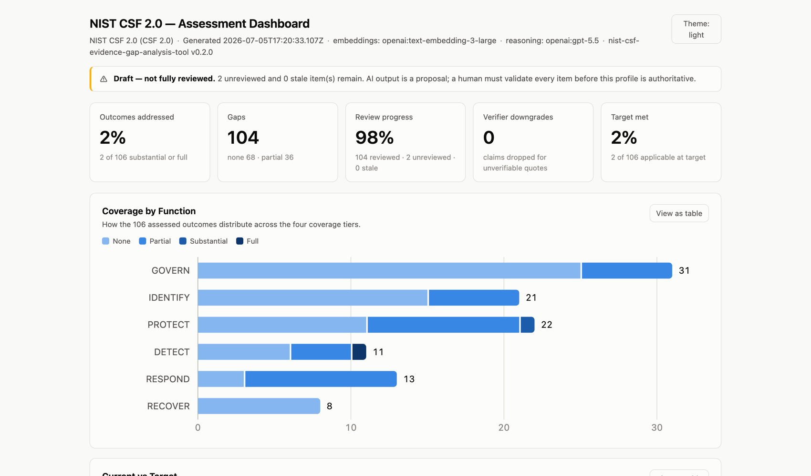
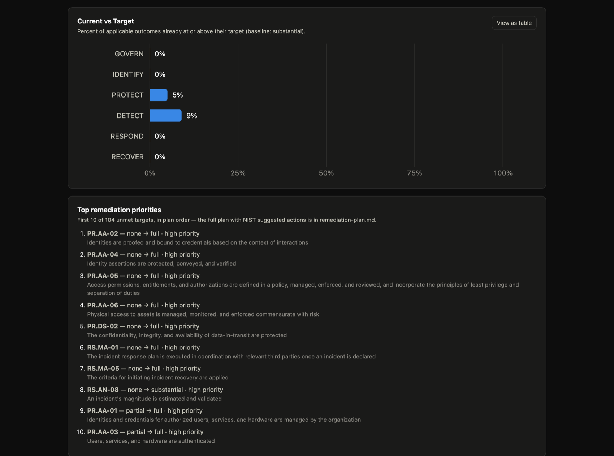
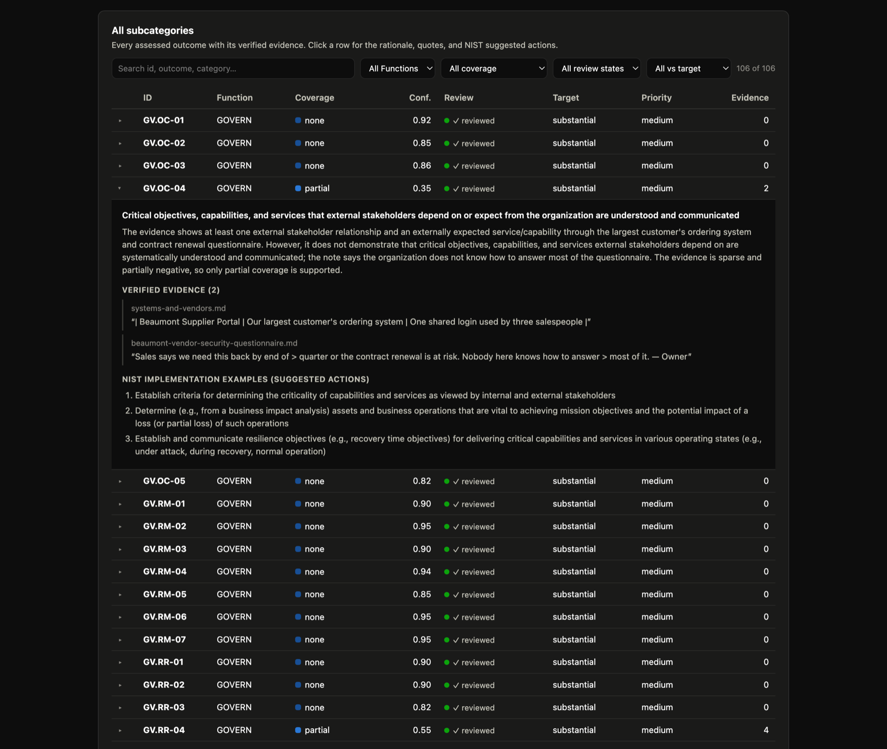

# NIST CSF 2.0 — AI-Assisted Evidence & Gap Analysis Tool

*Versión en español: [README.es.md](README.es.md).*

A free, open-source tool that helps any organization measure how well its
existing security practices meet the United States' national cybersecurity
standard — the NIST Cybersecurity Framework (CSF) 2.0 — and shows exactly where
the gaps are.

<p align="center">
  <picture>
    <source media="(prefers-color-scheme: dark)" srcset="docs/images/dashboard-dark.png">
    
  </picture>
</p>
<p align="center"><em>One of the deliverables: <code>dashboard.html</code> — a single self-contained file (no server, no network) with the whole assessment: coverage, review status, current-vs-target, and every outcome's verified evidence.</em></p>

## Purpose and significance

Cybersecurity is a recognized national priority in the United States: attacks on
businesses, hospitals, schools, utilities, and local governments cause serious
economic and public harm. To help organizations manage this risk, the U.S.
government's National Institute of Standards and Technology (NIST) publishes the
Cybersecurity Framework (CSF) 2.0 — a common, widely used national standard that
defines 106 cybersecurity outcomes an organization should achieve. (An "outcome"
is a concrete result the organization should be able to demonstrate — for
example, keeping an up-to-date inventory of its hardware.)

In practice, the evidence of how an organization actually protects itself is
spread across dozens or hundreds of documents — security policies, procedures,
audit reports, standards, and internal records, often scattered across different
teams and systems. Reading through all of that by hand and matching each piece
of evidence to the right outcome in the NIST framework is laborious, slow, and
error-prone, even for trained specialists. This is the main practical obstacle to
adopting the standard.

This project addresses that obstacle. It automatically reviews an organization's
own documents against all 106 outcomes defined by NIST CSF 2.0, locates the
supporting evidence and the gaps, and produces a clear report — accelerating work
that is laborious even for experienced security specialists. Because it is free,
open to everyone, and can run entirely on the user's own computer, sensitive
documents never have to leave the premises. This makes it practical for any
organization to produce a rigorous, evidence-based picture of where it stands
today against the standard — what the framework calls a "Current Profile" — and
makes the work faster and more consistent for the specialists who perform it.
Broader, more consistent adoption of a common cybersecurity baseline strengthens
the resilience of the wider economy and of critical public services.

To keep its results trustworthy, the tool never lets the AI have the final word:
every finding must be supported by an exact quote from the organization's own
documents, and a person reviews and confirms each one.

## Contents

- [Purpose and significance](#purpose-and-significance)
- [What it does](#what-it-does)
- [How it works](#how-it-works)
- [Install](#install)
- [Quick start (offline, no API key)](#quick-start-offline-no-api-key)
- [Usage](#usage)
- [Providers, privacy, and offline mode](#providers-privacy-and-offline-mode)
- [Outputs](#outputs)
- [How this supports CSF 2.0](#how-this-supports-csf-20)
- [Crosswalks to other frameworks](#crosswalks-to-other-frameworks)
- [Anti-hallucination safeguards](#anti-hallucination-safeguards) — with [measured results](eval/RESULTS.md)
- [Configuration](#configuration)
- [Data sources](#data-sources)
- [Limitations](#limitations)
- [Citing this tool](#citing-this-tool)
- [Project documentation](#project-documentation)
- [License](#license)

## What it does

Point the tool at a folder of your documents (security policies, SOC 2 reports,
ISO 27001 documentation, internal procedures). It then:

1. **Ingests** the documents — parses them, splits them into overlapping chunks,
   computes embeddings, and stores everything in a local on-disk index.
2. **Analyzes** coverage — for **every** one of the 106 CSF 2.0 Subcategories it
   retrieves the most relevant document chunks and asks an AI engine whether that
   evidence shows the outcome is actually achieved.
3. **Review** — a human-in-the-loop step where you accept, override, or annotate
   each AI judgment alongside its supporting evidence.
4. **Target** (optional) — you declare a Target Profile: the goal coverage for
   every outcome (with per-Function/Category/Subcategory overrides), remediation
   priorities, and outcomes that are out of scope. You can also record who owns
   each action and when it is due, and your organization's CSF Tier selection.
   All of these are human decisions; no AI is involved.
5. **Reports** — turns the reviewed assessments into a Current Profile (JSON), a
   gap-analysis report (Markdown), an evidence map (CSV), and a self-contained
   HTML dashboard — plus, when a target exists, a Target Profile (JSON) and a
   **prioritized remediation plan** whose suggested actions are NIST's own CSF
   2.0 Implementation Examples, quoted verbatim, with a POA&M-style tracker
   (CSV) of its open items. Three more reports read the same assessment from
   other angles: what each of your documents contributes, what to ask for where
   an outcome could not be demonstrated, and which identifiers of other
   frameworks (NIST SP 800-53, CIS Controls, and others) are related to each
   outcome.

The reports, the dashboard, and the `ask` answer can also be generated in
**Spanish** (`--lang es`). The tool's own wording is translated; the names of
the Functions and Categories and the Subcategory outcomes are shown in NIST's
official Spanish translation of CSF 2.0 (NIST CSWP 29 spa) — the tool does not
translate framework text itself. The assessment always runs on the English
Core, and the machine-readable files are the same in both languages.

At any point, the read-only **`status`** command summarizes the saved state of
those stages, identifies stale reviews or reports, and tells you the next command
to run.

Once documents are ingested, the read-only **`ask`** command answers a single
question from them, such as "is MFA required for remote access?". It shows an
answer only together with quotes it has verified verbatim in the documents;
otherwise it says that it found no verifiable evidence. The quotes are
verified — the summary sentence above them is the model's wording and is not.

For a full step-by-step walkthrough, see the **[Usage Guide](docs/GUIDE.md)**.

## How it works

### "Inverted RAG"

Instead of a user asking questions, the tool iterates over all Subcategories and,
for each one, retrieves the top-k closest document chunks and asks the AI to
evaluate coverage **against that retrieved evidence only**. Embeddings are
L2-normalized so cosine similarity is a plain dot product, and retrieval is an
exact in-memory scan — the corpus is one organization's documents, so no external
database or vector service is needed.

### Outcomes, not topics

CSF 2.0 Subcategories are *outcomes*, not controls or topics. The tool judges
whether the evidence shows an outcome is actually achieved — not merely that the
subject is mentioned. A policy that says something "must" happen is treated as
weaker evidence than records showing it actually happens.

## Install

Requires **Node.js >= 20.10**.

```bash
git clone https://github.com/MarianoFacundoArch/nist-csf-evidence-gap-analysis-tool.git
cd nist-csf-evidence-gap-analysis-tool
npm install
```

`npm install` pulls two small required dependencies (`ajv` for schema validation,
`@clack/prompts` for the interactive menu). The heavier provider/parser
dependencies (`openai`, `@huggingface/transformers`, `mammoth`, `pdfjs-dist`) are
declared as **optional** and are loaded only when the corresponding provider or
file type is actually used.

To use the command globally as `csf-tool`, run `npm link`. The linked command
can be run from any directory — a client's folder, for example: when that
directory has no `data/` files of its own, the CSF data shipped with the tool is
used. The examples below use `node bin/csf-tool.js`.

## Quick start (offline, no API key)

Run the whole pipeline against the bundled sample documents using a deterministic
**mock** engine — no network and no API key:

```bash
node bin/csf-tool.js all \
  --docs examples/sample-docs \
  --embed-provider mock --llm-provider mock \
  --work-dir ./output --accept-all
```

Then open `./output/reports/gap-analysis.md` — and `./output/reports/dashboard.html`
in a browser for the interactive view. A committed reference copy lives in
`examples/worked-example/`, regenerable byte-for-byte with `npm run example`.

(`--accept-all` accepts the review queue without asking, so the demo runs
unattended. By default the queue holds only the items flagged for review; the
others stay unreviewed, so the reports of this run are marked DRAFT. A real
assessment uses the human review step instead — see [Usage](#usage).)

## Usage

There are two ways to drive the tool, and they share the **same** underlying code.

**Interactive menu** (run with no command — it walks you through each step):

```bash
node bin/csf-tool.js
```

**Command mode:**

```bash
node bin/csf-tool.js init       # scaffold a config file, .env, and working dir
node bin/csf-tool.js ingest     # parse + chunk + embed + index your documents
node bin/csf-tool.js analyze    # AI coverage judgments for all 106 Subcategories
node bin/csf-tool.js review     # human-in-the-loop validation
node bin/csf-tool.js target     # define the Target Profile (goals + priorities)
node bin/csf-tool.js report     # generate the deliverables
node bin/csf-tool.js status     # inspect saved progress, freshness, and next step
node bin/csf-tool.js crosswalk  # list the crosswalks available to reports
node bin/csf-tool.js all        # run the whole pipeline end-to-end
node bin/csf-tool.js ask "Is MFA required for remote access?"   # question the ingested documents
```

The `target` stage is interactive in a terminal; for scripted runs use
`--target-default <level>` (set the baseline goal) or `--target-import <path>`
(bring your own spec, e.g. one derived from a NIST Community Profile), or edit
`<work-dir>/target.json` by hand — it is plain, validated JSON.
`--tier-current <1-4>` and `--tier-target <1-4>` record your organization's CSF
Tier selection the same way. The owner, due date, and status of individual
actions are recorded by hand in `target.json` (see the
[Usage Guide](docs/GUIDE.md#8-the-target-profile-and-the-remediation-plan)).

`--lang es` (or `"report": { "language": "es" }` in the config file) writes the
deliverables and the `ask` answer in Spanish; English is the default.
`report --lang es` only re-renders the assessment you have. With `analyze` and
`all`, it also asks the model to write its rationales in Spanish, so in a work
directory that was analyzed in English `analyze` assesses every outcome again
(see [Reports in Spanish](docs/GUIDE.md#reports-in-spanish)).

`--crosswalk <ids|default|all|none>` chooses the crosswalks that `report` and
`all` include — by default, all except third-party mappings (see
[Crosswalks to other frameworks](#crosswalks-to-other-frameworks)).

`ask` needs only the index that `ingest` built: it reads no assessment and
writes nothing. It reads the passages retrieved for the question
(`retrieval.topK`, 6 by default) and no others, so its "No verifiable evidence
in the ingested documents answers this question." means "not found there", not
"the documents say nothing about it".

Run `status` whenever you want a compact checkpoint without changing any
assessment data:

```bash
node bin/csf-tool.js status
```

The equivalent package-script form is `npm run status -- --work-dir <path>`.
It reports the state of ingest, analysis, review, target, and report generation;
distinguishes current reviews from reviews made stale by a changed assessment;
flags reports that predate newer ingest, analysis, review, or target activity
(or whose saved input snapshot or deliverable set no longer matches); validates
the hand-editable target; and ends with an actionable `Next: <command>`
recommendation. The same view is available from the interactive menu.
After upgrading a work directory created before v0.2.1, run the recommended
`report` command once to seed its exact input snapshot; subsequent hand edits
are then detected even when their timestamps are unchanged.

Each stage persists its output, so you can stop after any stage and resume later.
`analyze` is resumable — already-assessed items are skipped unless their inputs
changed (or you pass `--force`). Long-running stages also report useful progress:
ingest shows file position and percentage, analysis reports every ten outcomes
(including cache hits) with elapsed time and an approximate ETA, and review shows its queue
position. Run `--help` for all flags, and see the **[Usage
Guide](docs/GUIDE.md)** for a detailed walkthrough.

## Providers, privacy, and offline mode

The tool is pluggable. Nothing is hardcoded; you choose where embeddings and
reasoning happen.

- **Embeddings:** `local-transformers` (on-device — documents never leave your
  machine), `openai` (cloud), or `mock` (deterministic, tests).
- **Reasoning LLM:** `openai` (cloud), `ollama` (a fully-local model on your own
  machine), or `mock`.

The default is cloud-first (set `OPENAI_API_KEY` in `.env`). Pass **`--local`** for
a fully offline run (on-device embeddings + a local Ollama model); no document or
prompt ever leaves the machine. The offline path requires [Ollama](https://ollama.com):
install it, start it with `ollama serve`, and pull a model first (e.g.
`ollama pull llama3.2`). If `OLLAMA_HOST` is set to anything but a loopback
address, Ollama is not treated as local: prompts are sent to that host, and the
tool warns. Model names are configurable; if you leave a model unset,
each provider resolves a sensible default of its own, and the OpenAI provider
adapts automatically across model generations (e.g. the GPT-5 family's parameter
conventions).

### Redaction (opt-in)

With a cloud provider, text from your documents is sent to that provider.
`--redact` (or `"privacy": { "redact": true }` in the config file) replaces
e-mail addresses, URLs, IP and MAC addresses, host names, and the literal terms
you list in `privacy.terms` with placeholders such as `[[EMAIL_1]]` before a
request leaves the machine, and puts the originals back, locally, in the reply.
Quotes are still verified against your own documents, and the reports show the
original text.

**This is pseudonymization of identifiers that match a pattern or a listed
term. It is not anonymization**, and it does not make it safe to send documents
that must not leave the organization — use `--local` for those.

- Everything else is sent as written — the surrounding text, personal and
  company names (unless listed), job titles, postal addresses, phone numbers,
  account and identity numbers, passwords and keys, machine names without a dot,
  and document file names (unless they contain a listed term) — and can still
  identify the organization and the people in it.
- Turn it on before `ingest`. With redaction on, documents are cut into
  passages without splitting an address or a listed name, and `analyze` and
  `ask` refuse an index that was built without redaction or with a different
  `privacy.terms` list. A value in two pieces is still sent in part: one longer
  than a whole passage, a name or a URL that continues on the next page of a
  PDF, and a URL or an address that the document breaks across two lines.
- Only providers that are not on this machine are affected, and the tool judges
  that by the address. An Ollama daemon reached through a non-loopback
  `OLLAMA_HOST` counts as remote, and the tool warns about it; a local address
  that forwards to another machine looks local and is not redacted.
- Placeholders change what the model and the embedder see, which can change
  what is retrieved and how an outcome is judged. The published evaluation
  ([`eval/RESULTS.md`](eval/RESULTS.md)) was run without redaction and did not
  measure its effect.
- A `privacy` setting with an invalid value, a misspelled name, or in the wrong
  place stops the run with an error instead of being reset to "off", and so
  does a config file that cannot be read. Two mistakes are not caught, and in
  both nothing is redacted: the word `privacy` itself misspelled is an unknown
  key, ignored with a warning, and a command run from a directory that does not
  hold the config file uses the defaults. Check that `ingest`, `analyze`, and
  `ask` print "Redaction is on for …"; the Usage Guide shows how to check
  before anything is sent.
- After redaction is switched on or off, the tool says when `ingest` has to be
  run again, and it recomputes the assessments. Text already sent cannot be
  recalled.

The [Usage Guide](docs/GUIDE.md#redacting-identifiers-sent-to-a-cloud-provider)
shows a redacted request, lists exactly what is and is not replaced, and gives
the remaining limits in full.

## Outputs

Written to `<work-dir>/reports/`:

- **`current-profile.json`** — a machine-readable Current Profile aligned with the
  CSF 2.0 Organizational Profile concept: one entry per Subcategory with coverage
  (`none` / `partial` / `substantial` / `full`), confidence, evidence quotes, the
  AI vs. human values, review status, and the activity timestamps captured for
  the assessment.
- **`gap-analysis.md`** — a human-readable report grouped by Function, with a
  coverage summary and **gaps listed first** (plus a Current-vs-Target section
  when a target profile exists).
- **`evidence-map.csv`** — links each Subcategory to its source files and verbatim
  quotes (RFC-4180 quoting, with spreadsheet formula-injection protection).
- **`evidence-by-document.md`** — the reverse view: for each document, how many
  outcomes it was retrieved for, which outcomes it is quoted for, and how many
  verified quotes it supplies — followed by the documents that were ingested but
  never quoted. "Never quoted" means only that no passage was selected as
  verbatim evidence for a CSF outcome in this assessment; it does not mean the
  document is irrelevant.
- **`evidence-requests.md`** — what to ask for and collect next. Absence of
  evidence is assessed as `none`, but it is not absence of a control: often the
  organization does the thing and did not hand over the document. For every
  outcome that could not be demonstrated (with a target profile: every unmet
  target), the list gives three fixed questions and a checklist of what could
  demonstrate it — NIST's Implementation Examples for that outcome, verbatim.
- **`dashboard.html`** — a self-contained interactive dashboard (open it with a
  double click; works offline — no CDN, fonts, or network of any kind). Coverage
  charts, review status, and a filterable explorer of all 106 outcomes with
  their verified quotes; an evidence-by-document table; an assessment-activity
  snapshot with human-readable dates; quick filters for gaps, pending reviews,
  unmet targets, and everything needing attention; visible human-override
  indicators; broader search across rationale, notes, evidence, and suggested
  actions; light and dark themes; every chart has a table view. Because it is a
  generated offline file, its activity view is a snapshot as of report
  generation — run `report` again after newer work.

When a target profile exists, three more deliverables complete the CSF 2.0
Organizational Profile pair and its action plan:

- **`target-profile.json`** — the machine-readable Target Profile: current vs
  target coverage, gap size, priority, and scoping per Subcategory, with the
  plan fields and CSF Tier selection you recorded, if any.
- **`remediation-plan.md`** — the prioritized action plan connecting the two
  profiles: unmet targets ranked by your priorities and distance from the goal,
  each with NIST's official Implementation Examples as suggested actions
  (verbatim, public domain — the tool never invents recommendations), and the
  owner, due date, and status you recorded for it, if any.
- **`poam.csv`** — the same open items as a POA&M-style tracker (Plan of Action
  and Milestones): one row per unmet target, with a stable id and your owner,
  due date, status, and milestones. Those are read from `target.json` and never
  invented: a blank cell means nobody has decided yet. It is a plain tracker
  export, not a rendition of any agency's POA&M template.

When you recorded a CSF Tier selection, `gap-analysis.md`,
`remediation-plan.md`, and the dashboard show it, labeled as selected by the
organization.

For the selected crosswalks — by default, all except third-party mappings — two
more files relate the assessment to other frameworks (both are removed when
none is selected):

- **`crosswalk.md`** — how to read it, then, per crosswalk: who developed the
  mapping and where it is listed, and each of the framework's identifiers with
  the CSF 2.0 outcomes related to it and the coverage found for those outcomes.
- **`crosswalk.csv`** — the same relationships as data, one row each, for
  filtering in a spreadsheet or loading into a GRC tool.

The dashboard lists the same identifiers under each outcome, and its search
matches them.

No model is called to write the evidence-by-document report, the evidence
request list, the POA&M export, or the crosswalk files: they are computed from
the assessment, your target profile, and the shipped data, and the rationales
they repeat are the assessment's.

**Language.** With `--lang es`, the Markdown reports and `dashboard.html` are
written in Spanish under the same file names. Function names, Category names,
and outcomes are NIST's own published Spanish text; each report says so and
states that the assessment was made against the English original. NIST's
Implementation Examples are shown in English, because NIST publishes them in
English only, and quotes from your documents are never translated. The JSON
and CSV files are interfaces for other programs: their keys, headers, and
values stay English, and for the same assessment they are the same bytes in
both languages, apart from the generation timestamp.

<p align="center">
  
</p>
<p align="center"><em>Current vs Target and the ranked remediation queue — priorities and targets are yours; the ordering is deterministic.</em></p>

<p align="center">
  
</p>
<p align="center"><em>Every outcome, drill-down included: the AI's rationale, the quotes verified verbatim against your documents, and NIST's own suggested actions.</em></p>

Example excerpt from a gap-analysis report:

```
## Coverage by Function

| Function | Total | None | Partial | Substantial | Full | % addressed |
| --- | ---: | ---: | ---: | ---: | ---: | ---: |
| GOVERN | 31 | 16 | 15 | 0 | 0 | 0% |
| IDENTIFY | 21 | 13 | 7 | 1 | 0 | 5% |
...

## Gaps and partial coverage (address these first)

### IDENTIFY
- **ID.RA-01** — _none_
  - Outcome: Vulnerabilities in assets are identified, validated, and recorded
  - Rationale: The evidence shows asset inventory and access reviews, but does
    not demonstrate that vulnerabilities are identified, validated, and recorded.
```

## How this supports CSF 2.0

- **Comprehensive across the Framework Core.** It assesses the complete CSF 2.0
  Core — all 6 Functions, 22 Categories, and 106 Subcategories — and produces a
  Current Profile, the artifact CSF 2.0 recommends for understanding current
  cybersecurity posture.
- **The full Organizational Profile cycle.** CSF 2.0 frames an Organizational
  Profile as a Current Profile *and* a Target Profile, compared to produce an
  action plan. The tool covers the whole loop: assess → review → set targets →
  prioritized remediation plan, with the plan's suggested actions drawn verbatim
  from NIST's own CSF 2.0 Implementation Examples.
- **From gaps to a tracked plan.** Step 4 in CSF 2.0, Section 3.1, says to
  "develop a prioritized action plan (e.g., risk register, risk detail report,
  Plan of Action and Milestones [POA&M]) to address those gaps". The tool writes
  that plan and exports its open items as a POA&M-style tracker; who owns each
  item, and by when, is recorded by the people who decide it, never by the tool.
- **All three CSF 2.0 components.** CSF 2.0 consists of the Core, Organizational
  Profiles, and Tiers. In NIST's words (Section 3.2), "Tiers characterize the
  rigor of an organization's cybersecurity risk governance and management
  practices", and "An organization can choose to use the Tiers to inform its
  Current and Target Profiles." A Tier is selected by the organization and is
  not a function of Subcategory coverage, so the tool never derives or suggests
  one: it records your selection — current and target — and carries it through
  the deliverables, labeled as yours. For what each Tier means, see NIST CSWP
  29, Appendix B.
- **Informative references.** Mappings published through NIST's National Online
  Informative References (OLIR) Program relate CSF 2.0 outcomes to the controls
  and requirements of other frameworks. The tool ships a selection of them and
  lists, for each identifier in another framework, the assessed outcomes related
  to it — as relationships, never as a statement about that framework (see
  [Crosswalks to other frameworks](#crosswalks-to-other-frameworks)).
- **Accurate by construction.** The Subcategory text and Implementation Examples
  are taken verbatim from the official NIST CPRT export (reproducible with
  `npm run build-csf-core`), every AI coverage claim must be backed by a quote
  that is verified verbatim against the source evidence in code, and nothing is
  final until a human validates it.
- **Free and reusable.** MIT licensed; runs fully offline if desired; no account,
  subscription, or paid service is required to use it.

## Crosswalks to other frameworks

An organization rarely works with one framework. Once the CSF 2.0 outcomes have
been assessed, a common next question is "which controls in framework X does
this touch?". NIST publishes the relationships needed to answer it through its
National Online Informative References (OLIR) Program: mappings between CSF 2.0
and the elements of other documents, each listed with its developer in
[NIST's catalog](https://csrc.nist.gov/projects/olir/informative-reference-catalog).
The tool ships a selection of those mappings as data and adds none of its own:

| Id | Framework | Mapping developed by | Included |
| --- | --- | --- | --- |
| `sp800-53-r5` | NIST SP 800-53 Rev. 5.2.0 | NIST | by default |
| `sp800-171-r3` | NIST SP 800-171 Rev. 3 | NIST | by default |
| `sp800-218-ssdf` | NIST SP 800-218 (SSDF) v1.1 | NIST | by default |
| `csf-1.1` | NIST Cybersecurity Framework v1.1 | NIST | by default |
| `cis-v8.1` | CIS Critical Security Controls v8.1 | Center for Internet Security | by default |
| `csa-ccm-v4` | CSA Cloud Controls Matrix v4.0 | Cloud Security Alliance | by default |
| `cri-profile-v2` | CRI Profile v2.0 | Cyber Risk Institute | by default |
| `scf-2024.4` | Secure Controls Framework (SCF) 2024.4 | SCF Council | by default |
| `iso27001-2022` | ISO/IEC 27001:2022 | a third party (not the publisher) | on request |
| `pci-dss-4.0.1` | PCI DSS v4.0.1 | a third party (not the publisher) | on request |

List them for your copy of the data, and choose the ones a report includes:

```bash
node bin/csf-tool.js crosswalk
node bin/csf-tool.js report --crosswalk sp800-53-r5,cis-v8.1
```

`--crosswalk` takes ids, `default`, `all`, or `none`; `report.crosswalks` in the
config file makes the choice permanent.

**What a crosswalk tells you, and what it does not.**

- A mapping records that a CSF outcome and a reference are **related** — not
  that they are equivalent, or that achieving one satisfies the other.
- The coverage shown next to an outcome is evidence about **that CSF outcome
  only**, not a determination of conformance with the referenced control or
  requirement. The tool reports relationships, and how many references have a
  gap among their related outcomes — never a percentage or a status for the
  other framework.
- A mapping relates a reference to **one outcome, a whole Category, or a whole
  Function**. The deliverables keep those apart, and never reduce a whole
  Category to a single coverage value.
- The data holds **identifiers only** (control, requirement, or clause numbers).
  No control or requirement text is reproduced; consult each framework's own
  publication for what an identifier requires.
- Each mapping was made by **the developer named for it** in NIST's catalog. Its
  inclusion here is not an endorsement by NIST or by this project.

**Third-party mappings are opt-in.** By default the deliverables carry only
mappings developed by NIST or by the body that publishes the mapped framework.
For two standards for which the catalog lists no mapping by the publisher —
ISO/IEC 27001:2022 and PCI DSS v4.0.1 — the data includes mappings developed by
other parties. They must be chosen deliberately (name them, or use `all`), they
are labeled "third-party mapping" wherever they appear, and they are reproduced
as published, including entries that are non-specific or appear erroneous.

Read this way, a crosswalk is a navigation aid: it shows which assessed
outcomes — and so which of your documents and quotes — to open when you prepare
for work against another framework. The
[Usage Guide](docs/GUIDE.md#9-crosswalks-to-other-frameworks) shows how to read
`crosswalk.md` and `crosswalk.csv`.

## Anti-hallucination safeguards

The AI is constrained both by its prompt and, more importantly, by code:

- **Evidence-bound prompting.** The model may use only the evidence passed to it,
  must never assume an unseen control, and treats absence of evidence as `none`.
- **Quote or it doesn't count.** Any coverage above `none` must include at least
  one quote copied verbatim from the evidence.
- **Verbatim verification (in code).** After the model responds, the tool checks
  that each quote actually exists as a substring of the retrieved evidence
  (whitespace/case-normalized) and is substantive. If a coverage claim above
  `none` has no verifiable quote, it is **downgraded to `none`** and flagged. This
  is the authoritative check — the model's quoting is never trusted on faith.
- **Confidence threshold** flags low-confidence judgments for review.
- **Schema validation + graceful fallback.** Model output is validated; on invalid
  output the tool retries once, then falls back to `none` + needs-review — it
  never crashes.
- **Mandatory human review.** Unreviewed/stale items are clearly marked in every
  deliverable, and a **strict mode** refuses to emit the final profile until every
  item has been reviewed.

**These safeguards are measured, not asserted.** [`eval/RESULTS.md`](eval/RESULTS.md)
reports the experiments, and [`eval/`](eval/) contains the harness and the raw model
outputs behind every number:

| Experiment | Result |
| --- | --- |
| 13 models (cloud + local), 106 Subcategories | raw fabrication 0.0–17.7%; **delivered 0.0% on every model** |
| 122 crafted adversarial quotes | **100% caught**, 0% false rejection of legitimate quotes |
| Ablation over 642 real quotes | removing the verifier lets **4.7%** of delivered quotes be fabricated |

Faithfulness turned out to be model-*family* driven rather than size driven — a 9B
local model matched the cloud frontier while an 8B from another family fabricated
17.7% — which is the case for verifying in code rather than trusting any single model.

## Configuration

Precedence (low → high): built-in defaults < `csf-tool.config.json` < CLI flags.
Secrets/endpoints come from `.env` only. Run `csf-tool init` to scaffold a config.
A config file that is not a valid JSON object, or a `--config` path that names
no file, stops the run; with no config file at all the tool runs on its
defaults.
See the [Usage Guide](docs/GUIDE.md#14-configuration-reference) for the full
reference. Key fields: `csfCorePath`, `crosswalkPath`, `docsPath`, `workDir`,
`chunk.size`/`overlap`, `embeddings.provider`/`model`, `llm.provider`/`model`,
`llm.reasoningEffort`, `retrieval.topK`, `analysis.confidenceThreshold`,
`analysis.critique`, `analysis.strict`, `review.showAll`, `report.crosswalks`,
`report.language`, `privacy.redact`, `privacy.terms`.

`llm.reasoningEffort` (`low` | `medium` | `high`, default `low`) is a hint for
reasoning models that accept one and is ignored by models that do not. The
default is `low` because the measured sweep in
[`eval/RESULTS.md`](eval/RESULTS.md#4-reasoning-effort-sweep-gpt-55) found no
faithfulness gain from `medium` or `high` on this task, at roughly twice the
latency.

`report.crosswalks` selects the crosswalks included in reports — `null` (the
default) for all except third-party mappings, a list of ids for exactly those,
`[]` for none — and `privacy.redact` / `privacy.terms` control
[redaction](#redaction-opt-in). `report.language` (`en` | `es`, default `en`;
also `--lang`) selects the language of the reports, the dashboard, and the
`ask` answer.

Paths in the configuration are relative to the directory the tool is run from.
The built-in data paths are the one exception: when that directory has no
`data/csf-core.json` or `data/csf-crosswalks.json`, the copies shipped with the
tool are used. A file of your own at that path always wins, and a custom path
that does not exist is reported as not found rather than replaced by the
shipped file.

<!-- Anchor of this section before v0.4, kept so that existing links to it still work. -->
<a id="data-source-cprt"></a>

## Data sources

This project writes no framework text and no mapping of its own. The three data
files it ships are generated from NIST sources by scripts in `scripts/`, and
each can be regenerated and compared with the committed copy.

### CSF 2.0 Core (CPRT)

`data/csf-core.json` contains the complete CSF 2.0 Core — all 106 Subcategory
outcomes across 6 Functions and 22 Categories, each with its official NIST
Implementation Examples (the remediation plan's suggested actions) — generated
from the official NIST Cybersecurity and Privacy Reference Tool (CPRT) export.
The CSF 2.0 Core text and Implementation Examples are in the public domain.
Regenerate it from source (requires network and `unzip`):

```bash
npm run build-csf-core
```

To use your own export, point `csfCorePath` at a JSON file with the same shape
(see the [Usage Guide](docs/GUIDE.md#13-use-the-full-framework--your-own-csf-export)).

### Spanish text of the Core (NIST CSWP 29 spa)

`data/csf-core.es.json` holds the Spanish names and outcome statements of the 6
Functions, 22 Categories, and 106 Subcategories, reproduced verbatim from
Appendix A of NIST CSWP 29 spa, the official U.S. Government Spanish
translation of the Framework (<https://doi.org/10.6028/NIST.CSWP.29.spa>). This
project does not translate framework text. The file is read only by
`--lang es`, for display: the assessment always runs on the English Core, and
an element is shown in Spanish only when its English text in the Core being
assessed is NIST's official text. It has no Implementation Examples, because
NIST publishes those in English only. Regenerate it from the publication
(requires network and `pdftotext` from Poppler):

```bash
npm run build-csf-core-es
```

The script cross-checks the extracted text one-to-one against
`data/csf-core.json` (the same identifiers in the same order) and writes
nothing if they differ.

### Crosswalks (OLIR)

`data/csf-crosswalks.json` holds, for each crosswalk, the mapping's name,
version, developer of record, and release date as listed in NIST's catalog, and
the identifiers the mapping relates to each CSF 2.0 Function, Category, and
Subcategory — each relationship at the level the mapping records it. It is
generated from NIST's CSF 2.0 reference data service, which exposes the mappings
published through the [OLIR program](https://csrc.nist.gov/projects/olir).
Regenerate it from source (requires network):

```bash
npm run build-crosswalks
```

The script reads identifiers only. It checks the source against
`data/csf-core.json` and each mapping against its entry in NIST's catalog, and
stops with an explanation rather than write doubtful data. Which mappings are
shipped, and why, is documented at the top of `scripts/build-crosswalks.js`.
Links are limited to documents hosted by NIST, and the referenced frameworks
remain the property of their publishers, identified by reference only (see
[NOTICE](NOTICE)).

## Limitations

- **No OCR (v1).** PDFs are supported only when they contain a real text layer.
  Scanned/image-only PDFs are detected and skipped with a warning.
- **The AI is advisory.** Its output is a proposal; the human review step is
  mandatory. Do not treat an unreviewed profile as authoritative.
- **The `mock` provider is not a real model.** It is deterministic and exists only
  for tests and the reproducible worked example.
- **Model capability matters.** Very small local models tend to be over-conservative
  and return mostly `none`/`partial`; use a larger local model or a current cloud
  model for well-calibrated coverage. Human review is where coverage is confirmed.
- **Embedding-model consistency.** If you change the embedding model, re-run
  `ingest` — vectors from different models cannot be mixed.
- **Evidence is attributed by file name.** Two documents with the same file name
  in different folders cannot be told apart in the evidence. The
  evidence-by-document report counts them in one row and says so.
- **The evidence request list is a guide, not an audit program.** Its three
  questions are the same for every outcome, and its checklists are NIST's
  illustrative Implementation Examples — not an exhaustive list and not a
  baseline of required actions.
- **The plan fields and CSF Tiers are recorded, not assessed.** They are stored
  and reported exactly as you wrote them. The tool does not check a Tier against
  the coverage it measured, and it does not mark a plan item done when its
  target is met.
- **A crosswalk is not a conformance assessment.** The crosswalk deliverables
  show which assessed CSF outcomes are related to an identifier in another
  framework. They do not establish that a control or requirement of that
  framework is, or is not, met.
- **Mappings are reproduced, not vetted.** The tool adds no mapping of its own
  and does not check that a published one is right. The shipped file is a
  snapshot, dated when it was retrieved; nothing checks for newer mappings at
  run time (`npm run build-crosswalks` refreshes it).
- **Redaction is not anonymization.** It replaces identifiers that match a
  pattern or a listed term and sends everything else as written, and it can be
  off without an error when the word `privacy` is misspelled or the config file
  is in another directory (see [Redaction](#redaction-opt-in)).
- **`ask` verifies quotes, not the answer.** The summary sentence is the model's
  wording, and a verified quote is a passage that exists in your documents — not
  proof that it answers the question, or that what a policy requires is
  actually done. Only the passages retrieved for the question are read. The
  experiments in [`eval/RESULTS.md`](eval/RESULTS.md) measured the assessment,
  not `ask`.
- **Spanish output covers the deliverables, not the tool's own messages.** Log
  lines, `status`, the interactive menu, the review and target prompts, and
  `--help` are in English. So are NIST's Implementation Examples, which NIST
  publishes in English only, and any outcome of a tailored CSF Core that is not
  NIST's official text.
- **The language of AI-written text depends on the model, and was not
  evaluated.** With `--lang es` the model is asked to write each rationale (and
  each `ask` summary) in Spanish; whether it does is up to the model, and the
  `mock` provider always writes English. Rationales written before the language
  was set stay as they are. The experiments in
  [`eval/RESULTS.md`](eval/RESULTS.md) used the English prompts, and the added
  instruction has not been run against a real model in this project's tests or
  evaluation. The verifier is the same in both languages.

## Citing this tool

To cite this tool, use the metadata in [`CITATION.cff`](CITATION.cff): title,
author, version, and release date.

## Project documentation

- [README.es.md](README.es.md) — this README in Spanish.
- [Usage Guide](docs/GUIDE.md) — detailed, explained walkthrough.
- [CONTRIBUTING](CONTRIBUTING.md) — development setup and how to contribute.
- [CHANGELOG](CHANGELOG.md) — release notes.
- [AUTHORS](AUTHORS) — maintainers and contributors.
- [NOTICE](NOTICE) — data provenance and third-party licenses.

## License

MIT — see [LICENSE](LICENSE). Free and open source.
